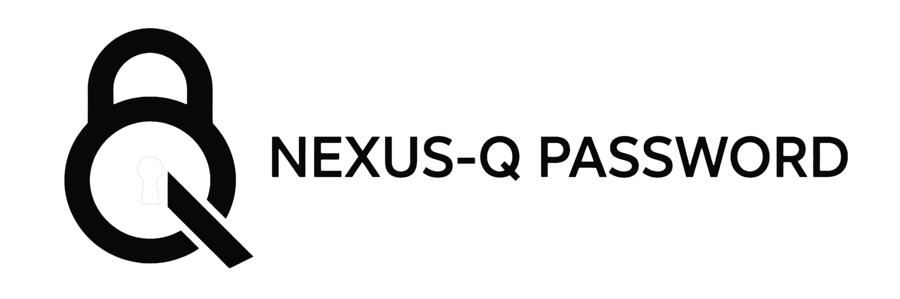
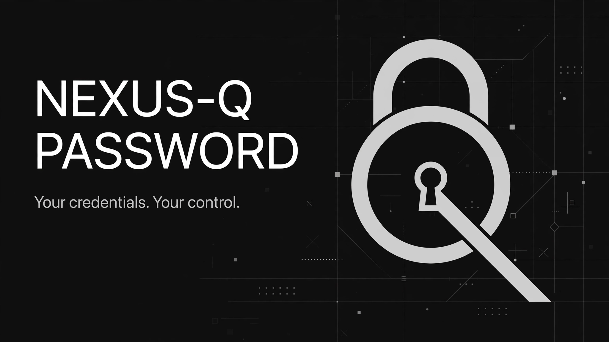

<p align="center">
  
</p>

<p align="center">
  <a href="https://github.com/lecodev-26/nexus-q-password/actions/workflows/build.yml"></a>
  
  
  
  
  
</p>

<p align="center">
  
</p>

# NEXUS-Q Password

**Your credentials. Your control.**

NEXUS-Q Password is an independent, local-first desktop password manager designed to generate strong passwords and manage credentials in a locally encrypted vault. It is built with **Rust, Tauri 2, Svelte 5, TypeScript and Vite**.

> **Development status:** version `0.1.0` is the initial development baseline. The complete feature set, native packaging, end-to-end validation and independent security review are not yet complete. Do not store real credentials in the current development build.

## Product principles

- **Local-first:** no cloud account, hosted service or network connection is required for core password management.
- **Privacy by default:** credential content, master passwords and key material must never enter logs, telemetry, crash reports or issue attachments.
- **Fail closed:** malformed, unsupported or tampered vault data must never yield partial plaintext.
- **Independent application:** Password has its own codebase, storage, lifecycle and security boundary; it does not depend on NEXUS-Q Sign or NEXUS-Q Vault.
- **Consistent ecosystem experience:** the interface follows the shared NEXUS-Q desktop design language.

## Planned 0.1.0 scope

- Master-password protected local vault with create, unlock, lock and password change.
- Credential creation, editing, deletion, search, categories, tags and favorites.
- Cryptographically secure password generator and local password-reuse indicators.
- Automatic locking and clipboard clearing with platform-aware safeguards.
- Independently encrypted backups and documented import/export.
- A separately specified NEXUS-Q identity protection/transfer capability, gated on protocol design and security review.
- Native Linux, Windows and macOS desktop packages.

These are release goals, not claims that all features are implemented. See [PRODUCT.md](docs/PRODUCT.md).

## Technology

| Layer | Technology |
| --- | --- |
| Desktop shell | Tauri 2 |
| Frontend | Svelte 5 + TypeScript |
| Frontend tooling | Vite |
| Native backend | Rust |
| Password generation | OS CSPRNG with unbiased selection |
| Vault key derivation | Argon2id |
| Vault authenticated encryption | XChaCha20-Poly1305 |

The cryptographic implementation and vault format are under development and review. See the [security architecture](docs/architecture/SECURITY_ARCHITECTURE.md), [vault format](docs/architecture/VAULT_FORMAT_V1.md) and [threat model](docs/security/THREAT_MODEL.md).

## Architecture

```text
NEXUS-Q Password
├── apps/desktop
│   ├── src/                 Svelte + TypeScript interface
│   ├── public/              Static frontend assets
│   ├── icons/               Native application icons
│   └── src/                 Rust/Tauri application entry points
├── crates/password-core    Password generation and vault cryptography
├── assets/branding          Logo, banner and original brand assets
├── docs/                    Product, architecture and security documents
└── .github/workflows        Manual validation and artifact generation
```

The desktop application is independent of Sign and Vault. It does not share their databases, sessions, identities, keys or runtime services.

## Build from source

### Prerequisites

- Node.js and npm.
- Rust stable toolchain.
- Tauri 2 system dependencies for your operating system.
- The platform SDK and compiler required by Tauri.

Follow the official [Tauri prerequisites](https://v2.tauri.app/start/prerequisites/) for your platform.

### Install frontend dependencies

```bash
cd apps/desktop
npm ci
```

### Run in development

```bash
cd apps/desktop
npx tauri dev
```

### Build a desktop bundle

```bash
cd apps/desktop
npx tauri build
```

### Run checks

```bash
cd apps/desktop
npm run check
npm run build

cd ../..
cargo fmt --manifest-path apps/desktop/Cargo.toml -- --check
cargo test --locked --manifest-path crates/password-core/Cargo.toml
```

## Continuous integration

GitHub Actions is manually triggered with `workflow_dispatch`. It validates the project and generates temporary native build artifacts for supported platforms. Artifacts are retained for a limited period.

The workflow does not deploy the application, publish GitHub Releases or attach binaries to releases. A successful build is not a substitute for manual installation testing, end-to-end validation or an independent security review.

## Security reporting

See [SECURITY.md](SECURITY.md). Do not submit real passwords, vault files, private keys or recovery material in issues or reports. Please report suspected vulnerabilities privately to the maintainers.

## License

The project is currently published without a declared open-source license. All rights are reserved unless a license is added to this repository.
